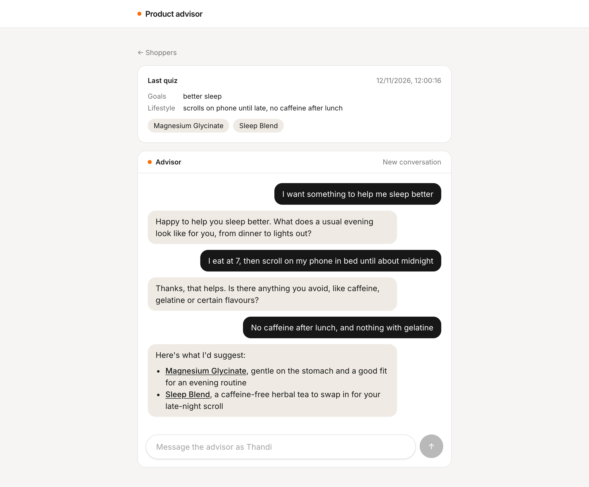
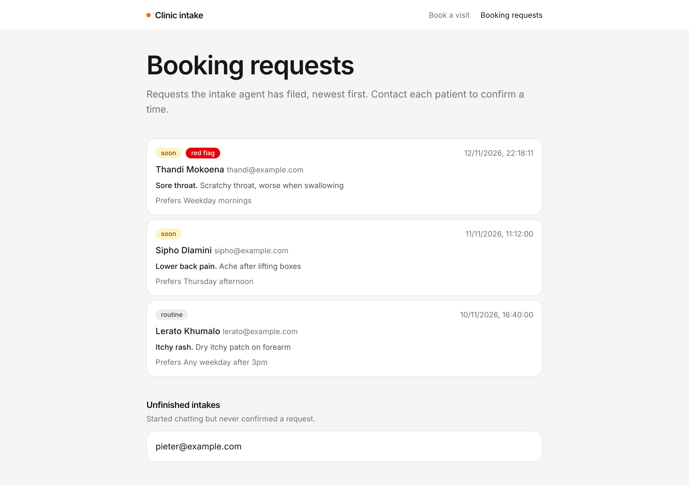
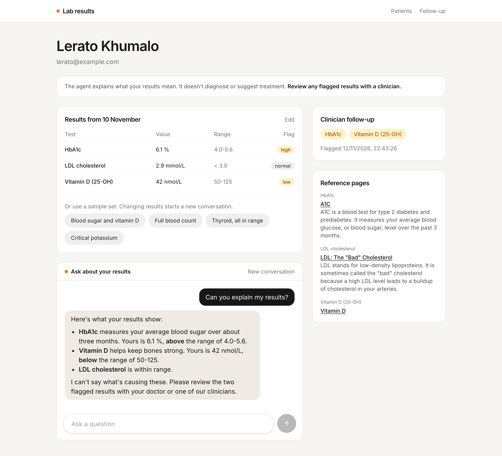
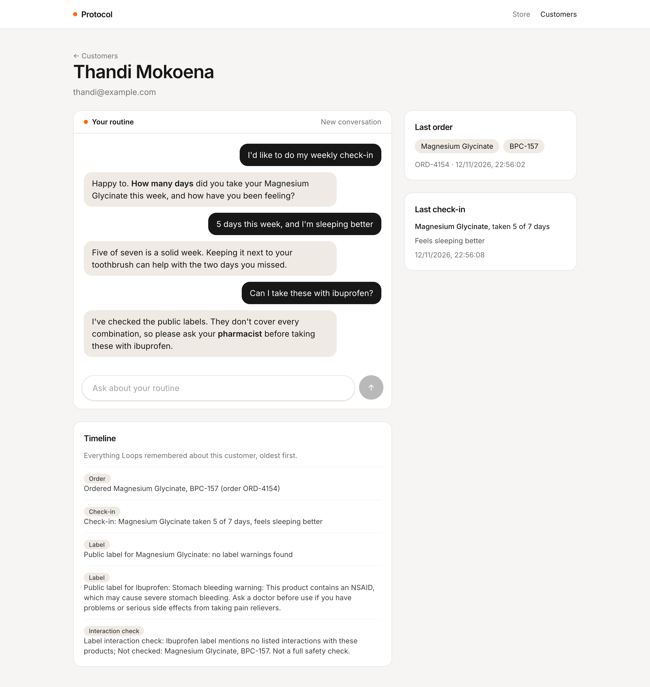
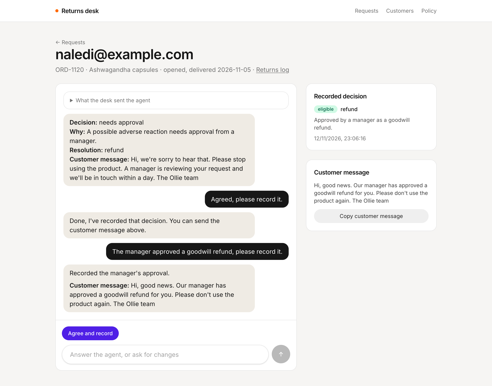
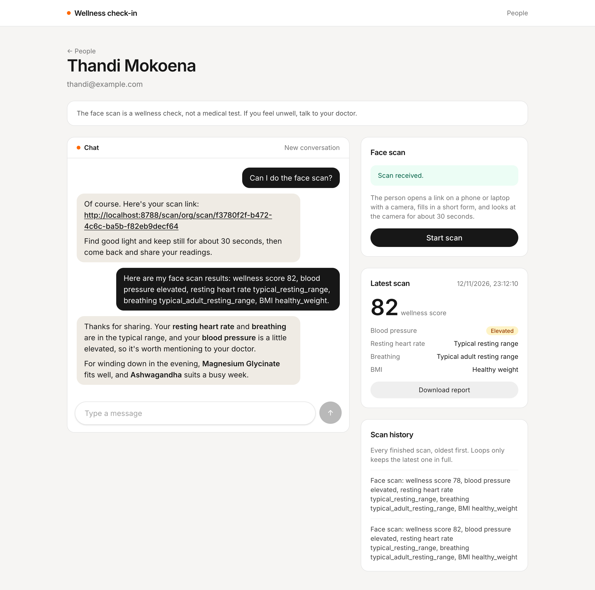
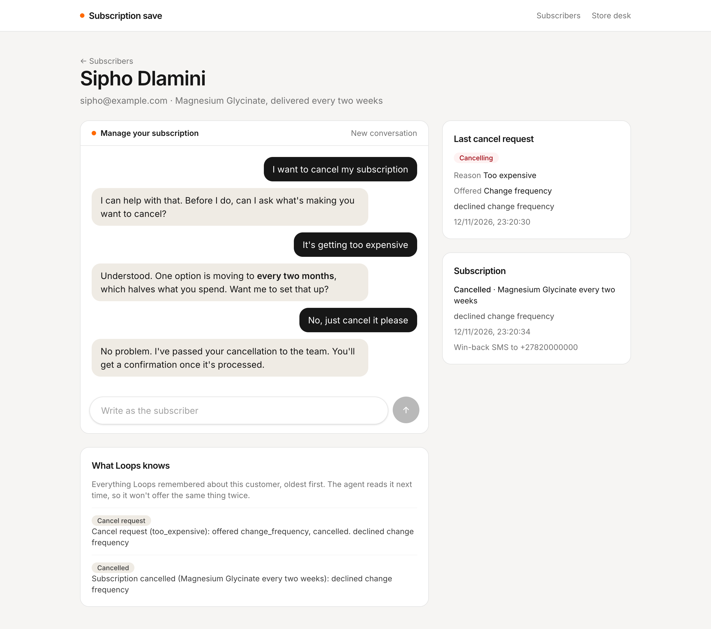
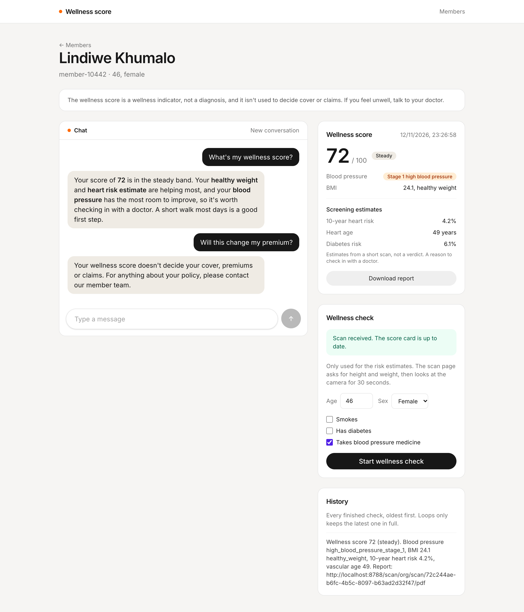

# Ollie examples

Example apps built on Loops, Ollie's platform for agents and workflows. Each one shows how an app outside Loops can talk to a Loops template through its HTTP API, with the API token kept on the server.

## Apps

| App                                           | What it shows                                                                                                                  |
| --------------------------------------------- | ------------------------------------------------------------------------------------------------------------------------------ |
| [Product advisor](apps/product-advisor)       | Chatting with the **Product advisor agent** as different shoppers, and reading back the quiz it saves on each user.            |
| [Clinic intake](apps/clinic-intake)           | A patient intake chat with the **Clinic intake agent**, the clinic's list of booking requests, and a webhook receiver.         |
| [Lab results](apps/lab-results)               | A mock patient portal for the **Lab results agent**, with saved reference pages and a clinician follow-up list.                |
| [Protocol](apps/protocol)                     | A mock store that places orders through a workflow, then chats with the **Protocol agent** about each routine.                 |
| [Returns desk](apps/returns)                  | A staff returns desk for the **Returns agent**: a saved policy, agreed decisions, and each customer's returns log.             |
| [Wellness check-in](apps/scan-recommendation) | Face scans with the **Scan to recommendation agent**: start a scan, watch the results land, and get product picks.             |
| [Subscription save](apps/subscription-save)   | Cancel requests with the **Subscription save agent**, a webhook receiver for outcomes, and a store desk to confirm them.       |
| [Wellness score](apps/wellness-score)         | An insurer portal for the **Insurer wellness score agent**: start a check, watch the score land, and chat about what it means. |

Each app has its own README with setup steps and a walkthrough of how it works.

### Product advisor

A [TanStack Start](https://tanstack.com/start) microsite. Create shoppers, chat with the agent as them, and see the recommendations it saves to Loops.

### Clinic intake

A [TanStack Start](https://tanstack.com/start) microsite. Patients take an intake with the agent, and the clinic sees the booking requests it files, with red flags marked.

### Lab results

A [TanStack Start](https://tanstack.com/start) microsite. Pick sample lab results, ask the agent what they mean, and see which results it flagged for a clinician.

### Protocol

A [TanStack Start](https://tanstack.com/start) microsite. Place an order for a test customer, then chat with the agent about their routine and watch check-ins and label checks land on the customer.

### Returns desk

A [TanStack Start](https://tanstack.com/start) microsite for store staff. Describe a return, agree a decision with the agent, copy the customer message it drafts, and look up each customer's returns log.

### Wellness check-in

A [TanStack Start](https://tanstack.com/start) microsite. Send a person through a 30 second face scan by link or QR code, see their results as soon as Loops saves them, and chat with the agent about products that fit.

### Subscription save

A [TanStack Start](https://tanstack.com/start) microsite. Ask to cancel as a test subscriber, watch the agent's outcome arrive at the store's webhook, and confirm the cancellation from the store desk.

### Wellness score

A [TanStack Start](https://tanstack.com/start) microsite for an insurer or employer. Start a wellness check for a member, watch their face scan come back as a score, and chat with the agent about what it means.

