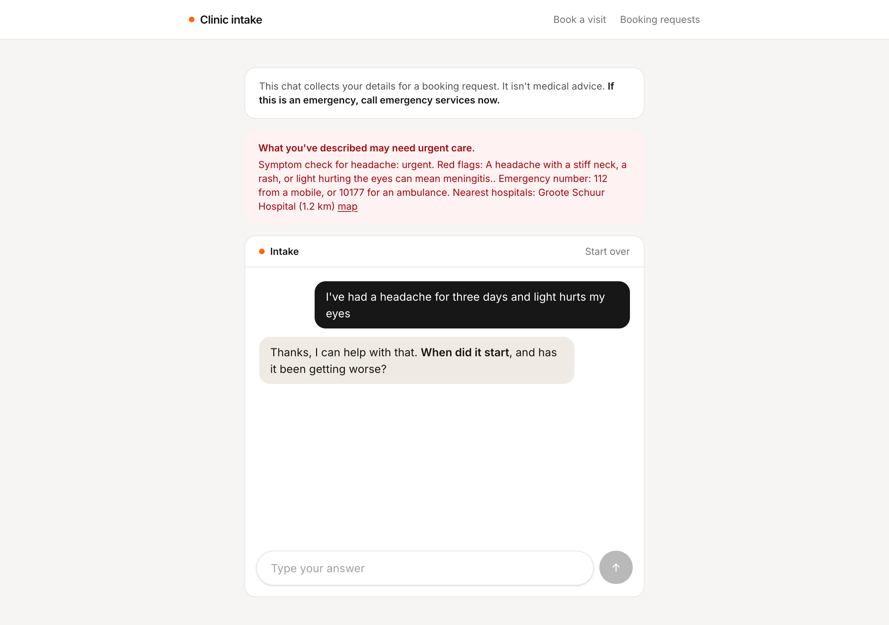
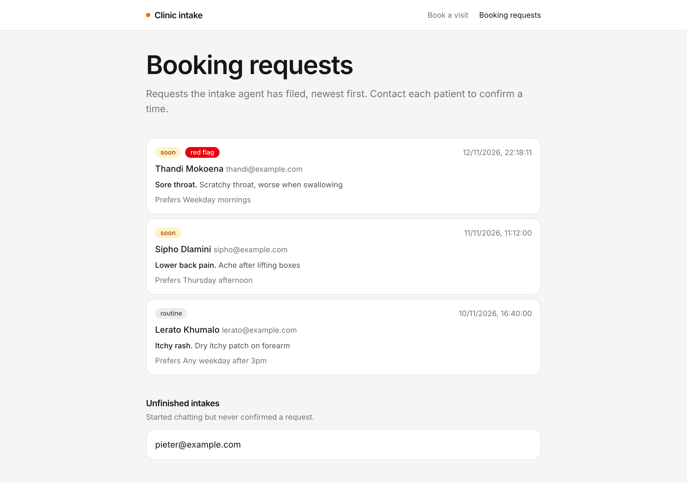
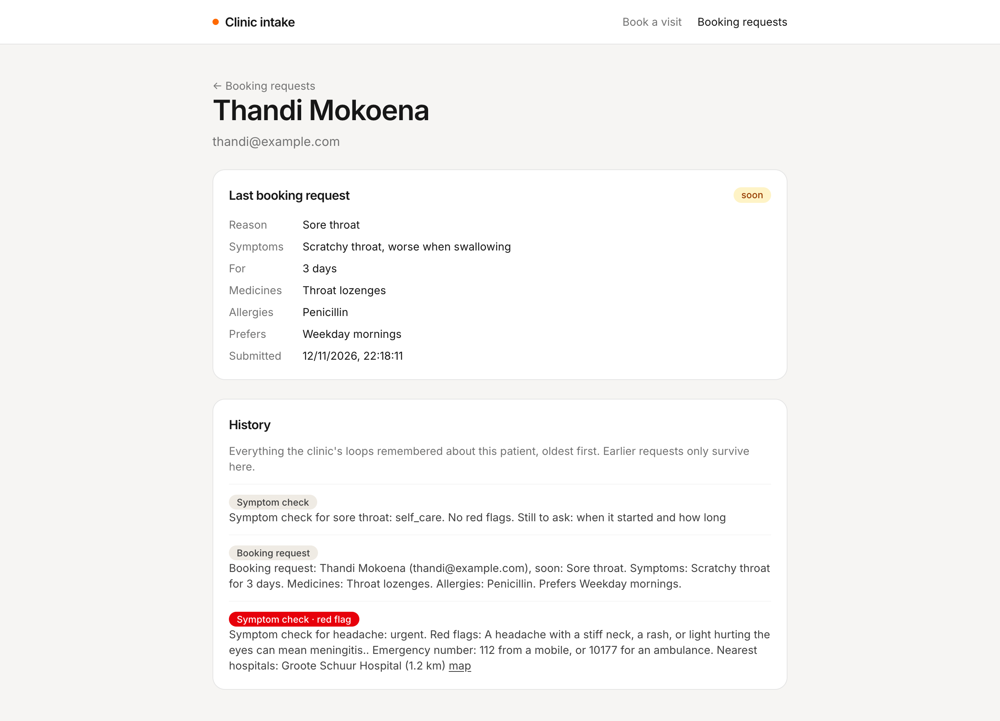
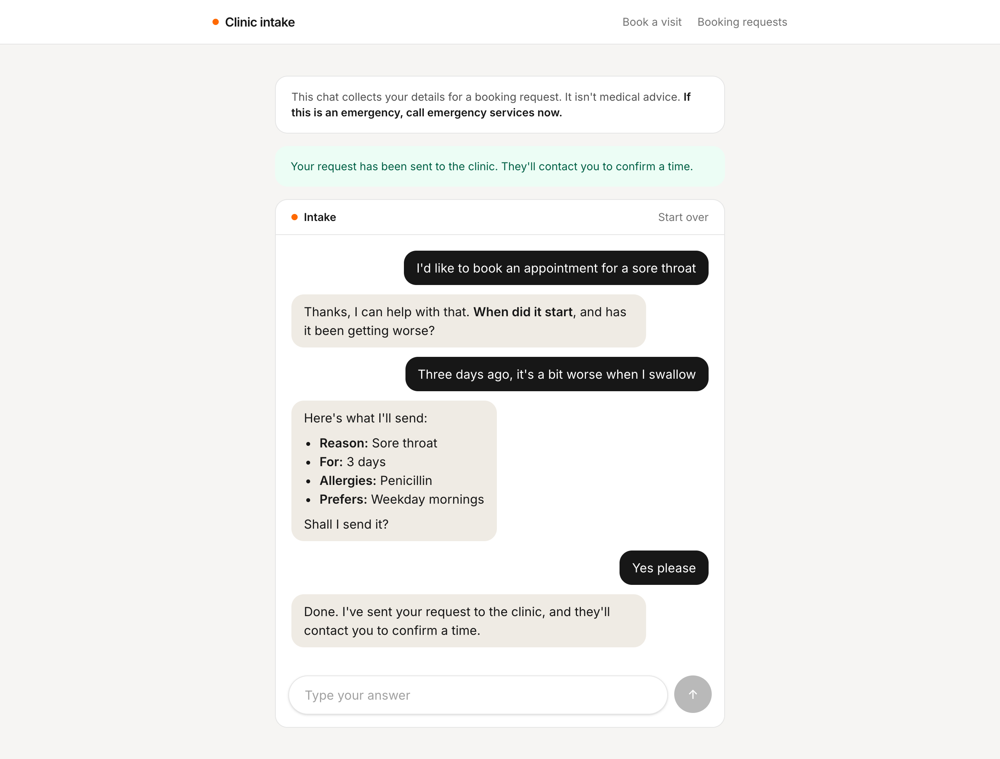

# Clinic intake

A small [TanStack Start](https://tanstack.com/start) app for testing the Loops **Clinic intake agent**. Patients fill in a short form and chat with the agent, which takes their intake and files a booking request. The clinic side lists those requests from Loops, with red flags marked, and receives the clinic webhook.



| Booking requests                                                                         | A patient                                                        |
| ---------------------------------------------------------------------------------------- | ---------------------------------------------------------------- |
|  |  |

## Run it

1. Run Loops locally (the API listens on `http://localhost:8787`), sign in to the dashboard, and deploy the **Clinic intake agent** template.
2. Copy the organization id and the `clinic-intake` loop id from the loop's page.
3. In **Settings → API tokens**, create a token for that loop with access set to **Run and read**.
4. Copy `.env.example` to `.env` and fill in those values.
5. From the repository root, run `bun install` and then `bun run dev --filter=clinic-intake`. The app runs on `http://localhost:3002`.

Restart the dev server after changing `.env`.

Optionally, set `CLINIC_COUNTRY` (for example `South Africa`) on `clinic-symptom-check` so red flags come with the right emergency number.

## How it works

| File                                        | What it does                                                          |
| ------------------------------------------- | --------------------------------------------------------------------- |
| `src/lib/loops.ts`                          | Server functions for the Loops endpoints, and helpers to read memory. |
| `src/lib/patients.ts`                       | What Loops doesn't store: names, areas, thread ids and transcripts.   |
| `src/lib/arrivals.server.ts`                | When each webhook arrived, kept in `.data/booking-arrivals.json`.     |
| `src/routes/index.tsx`                      | The patient form.                                                     |
| `src/routes/intake.$patientId.tsx`          | The intake chat.                                                      |
| `src/routes/clinic.index.tsx`               | The clinic's booking requests.                                        |
| `src/routes/clinic.$patientId.tsx`          | A patient's last request and everything Loops remembered about them.  |
| `src/routes/api/booking-requests.$token.ts` | The webhook receiver.                                                 |

### Keeping the token on the server

The API token can run and read the agent, so it must never reach the browser. Every call to Loops lives in a `createServerFn` in `src/lib/loops.ts`. The browser calls the server function, and only the server talks to Loops.

### The three endpoints

| Endpoint              | Used for                                                      |
| --------------------- | ------------------------------------------------------------- |
| `POST /chat`          | Sending one message and getting the reply.                    |
| `GET /users`          | The booking requests list, 50 at a time with **Load more**.   |
| `GET /users/{userId}` | A patient's last request and memory. `404` means nothing yet. |

All three paths start with `/loop/{organizationId}/{loopId}`. The app only talks to the agent. Its two workflows, `clinic-symptom-check` and `clinic-intake-record`, are started by the agent's tools.

### Telling the agent who it's talking to

The chat API has no user field, so the first message of every thread starts with an intro line. The patient's email is their Loops id, since the agent's tools expect an email or phone number. The area is optional, and lets the symptom check find nearby hospitals:

```
Hi, I'm Thandi Mokoena. My email is thandi@example.com. I'm in Observatory, Cape Town.

I've had a headache for three days
```

Loops remembers everything said in a thread, so later messages are sent on their own. Loops has no endpoint for reading a thread back, so the app keeps its own copy of the transcript. **Start over** begins a new thread.

### Results arrive after the reply

Both tools start a workflow and return straight away, so the agent never sees what the symptom check found, and the results land on the patient a few seconds later. After each reply, the intake page checks `GET /users/{email}` every 3 seconds for up to 30 seconds:

- A new memory line starting "Symptom check for" means a check finished. If it contains "Red flags:", the page shows it in a red banner, with the emergency number and hospital links. The agent can't say these itself.
- When `metadata.lastIntake.submittedAt` changes, the page says the request has been sent.

The emergency notice above the chat is always shown, because the agent only warns about emergencies it recognises from the conversation.

### The clinic's view

`GET /users` returns ids only, so the booking requests page reads each patient too. That's fine for a small clinic, but cache the reads for many patients. Patients with `metadata.lastIntake` are listed newest first. Patients with symptom checks but no request are under **Unfinished intakes**.

A row is marked **red flag** if any of the patient's symptom check lines contains "Red flags:". That's the only place the check's result is saved.

### The webhook

Set `BOOKING_WEBHOOK_TOKEN` to a long random string, then set `BOOKING_WEBHOOK_URL` on `clinic-intake-record` to:

```
https://<your app>/api/booking-requests/<BOOKING_WEBHOOK_TOKEN>
```

Also add your app's host under **Controls → Allowed hosts** on that loop. When Loops runs in the cloud, the app needs a public URL.

The webhook isn't signed, so the hard-to-guess path is the only check. The receiver saves just the `patientId` and the time, and the page reads the details from Loops. Requests that arrived since the clinic last opened the page get a **new** badge.

To try it without the agent:

```sh
curl -X POST http://localhost:3002/api/booking-requests/<token> -d '{"patientId":"thandi@example.com"}'
```

## Try it

1. Start an intake with "I'd like to book an appointment for a sore throat". Answer the questions and confirm the summary. Within about 30 seconds the page says your request has been sent.
2. Open **Booking requests**. The patient is listed with their urgency, reason and preferred times.
3. Click **Start over** and describe a headache with a stiff neck. A red banner shows the red flag, and the patient's row is marked **red flag**.
4. Leave an intake before confirming. The patient shows under **Unfinished intakes**.
5. Set up the webhook and confirm another intake, then reload **Booking requests**. The patient has a **new** badge.


