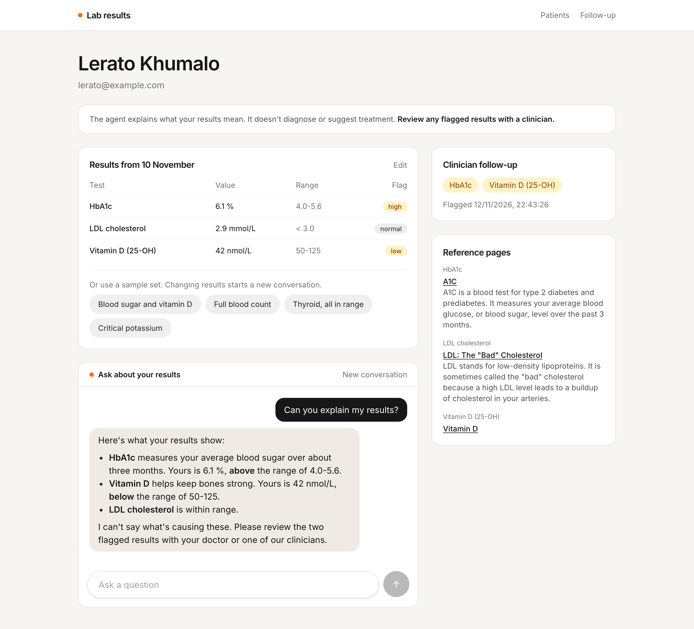
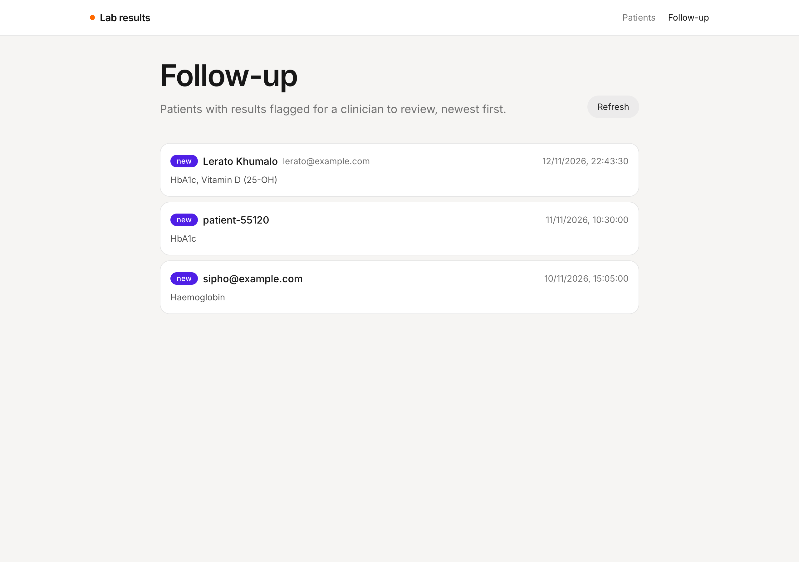
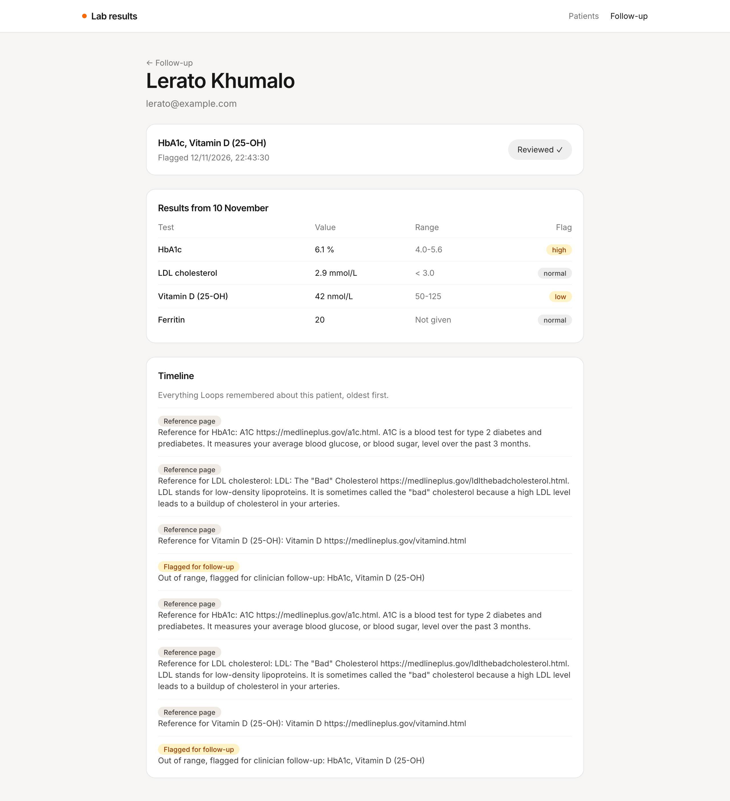
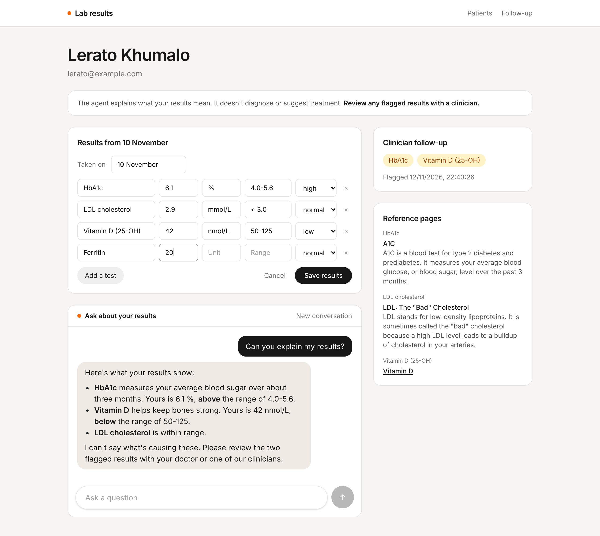

# Lab results

A small [TanStack Start](https://tanstack.com/start) app for testing the Loops **Lab results agent**. It's a mock patient portal: add a test patient, pick or enter a set of lab results, and ask the agent what they mean. The page shows the reference pages Loops saved and whether anything was flagged. A clinician view lists every patient with results flagged for follow-up.



| Follow-up list                                                           | A flagged patient                                                            |
| ------------------------------------------------------------------------ | ---------------------------------------------------------------------------- |
|  |  |

## Run it

1. Run Loops locally (the API listens on `http://localhost:8787`), sign in to the dashboard, and deploy the **Lab results agent** template.
2. Copy the organization id and the `lab-results` loop id from the loop's page.
3. In **Settings → API tokens**, create a token for that loop with access set to **Run and read**.
4. Copy `.env.example` to `.env` and fill in those values.
5. From the repository root, run `bun install` and then `bun run dev --filter=lab-results`. The app runs on `http://localhost:3004`.

Restart the dev server after changing `.env`.

## How it works

| File                                  | What it does                                                           |
| ------------------------------------- | ---------------------------------------------------------------------- |
| `src/lib/loops.ts`                    | Server functions for the Loops endpoints, and helpers to read memory.  |
| `src/lib/samples.ts`                  | The sample result sets, and how a result is written out for the agent. |
| `src/lib/patients.ts`                 | What Loops doesn't store: names, results, transcripts and reviews.     |
| `src/routes/index.tsx`                | Adding a test patient.                                                 |
| `src/routes/patients.$patientId.tsx`  | The patient's results, the chat, reference pages and follow-up.        |
| `src/routes/clinician.index.tsx`      | Every patient flagged for follow-up.                                   |
| `src/routes/clinician.$patientId.tsx` | One flagged patient, with **Mark reviewed** and the timeline.          |

### Keeping the token on the server

The API token can run and read the agent, so it must never reach the browser. Every call to Loops lives in a `createServerFn` in `src/lib/loops.ts`. The browser calls the server function, and only the server talks to Loops.

### The three endpoints

| Endpoint              | Used for                                                       |
| --------------------- | -------------------------------------------------------------- |
| `POST /chat`          | Sending one message and getting the reply.                     |
| `GET /users`          | Finding every patient for the follow-up list.                  |
| `GET /users/{userId}` | A patient's reference pages and flag. `404` means nothing yet. |

All three paths start with `/loop/{organizationId}/{loopId}`. The app only talks to the agent. The `lab-education-lookup` workflow is started by the agent's tool.

### Sending the results

The chat API takes text only, and Loops doesn't store result values. So the app keeps each patient's results in the browser, and the first message of every thread carries an intro line and the results as a list:

```
Hi, I'm Lerato Khumalo. My email is lerato@example.com.

Here are my results from 10 November:
- HbA1c: 6.1 % (reference range 4.0-5.6, flagged high)
- LDL cholesterol: 2.9 mmol/L (reference range < 3.0, normal)
- Vitamin D (25-OH): 42 nmol/L (reference range 50-125, flagged low)

Can you explain my results?
```

The email is the patient's Loops id, since the agent's tool expects an email or phone number. Tests use their full names, which find reference pages more often. A blank unit or range is left out, and the agent asks for it.

Each conversation is about one set of results, so changing them, by editing or picking a sample set, starts a new thread. Loops has no endpoint for reading a thread back, so the app keeps its own copy of the transcript.

### Reference pages and the follow-up flag

After explaining, the agent starts `lab-education-lookup`, which finishes a few seconds after the reply. It saves a memory line for each test with a MedlinePlus page, and sets `metadata.labFollowUp` when the agent judged tests out of range. So after each reply, the patient page checks `GET /users/{email}` every 3 seconds for up to 30 seconds, until new "Reference for" lines appear or `flaggedAt` changes.

Every lookup saves its pages again, so the app drops repeated URLs. If nothing appears, the agent didn't run the lookup, or MedlinePlus had no page for those names.

### Follow-up and reviews

Loops can't filter users by metadata, so the follow-up list reads every user and keeps those with `labFollowUp`. That's one request per user, which is fine for a test organization. For a real one, cache the reads in your app. The list doesn't refresh on its own, so use **Refresh**.

The flag never clears, and Loops can't record a review. So **Mark reviewed** saves the patient's current `flaggedAt` in the browser. When a later lookup flags new tests, `flaggedAt` changes and the patient shows as **new** again.

## Try it

1. Add a patient. They start with the first sample set. Click **Can you explain my results?**. Within about 30 seconds, reference pages appear and the follow-up panel lists HbA1c and Vitamin D (25-OH).
2. Open **Follow-up**. The patient is listed as **new**. Open them and click **Mark reviewed**.
3. Back on the patient, pick **Critical potassium** and ask again. The agent tells them to contact their doctor today. Once the lookup lands, the patient shows as **new** on the follow-up list.
4. Click **Edit**, add "Ferritin" with a value of 20 and nothing else, and ask about it. The agent asks for the unit and range.
5. Pick **Thyroid, all in range**. Nothing new is flagged, and the old flag stays.


