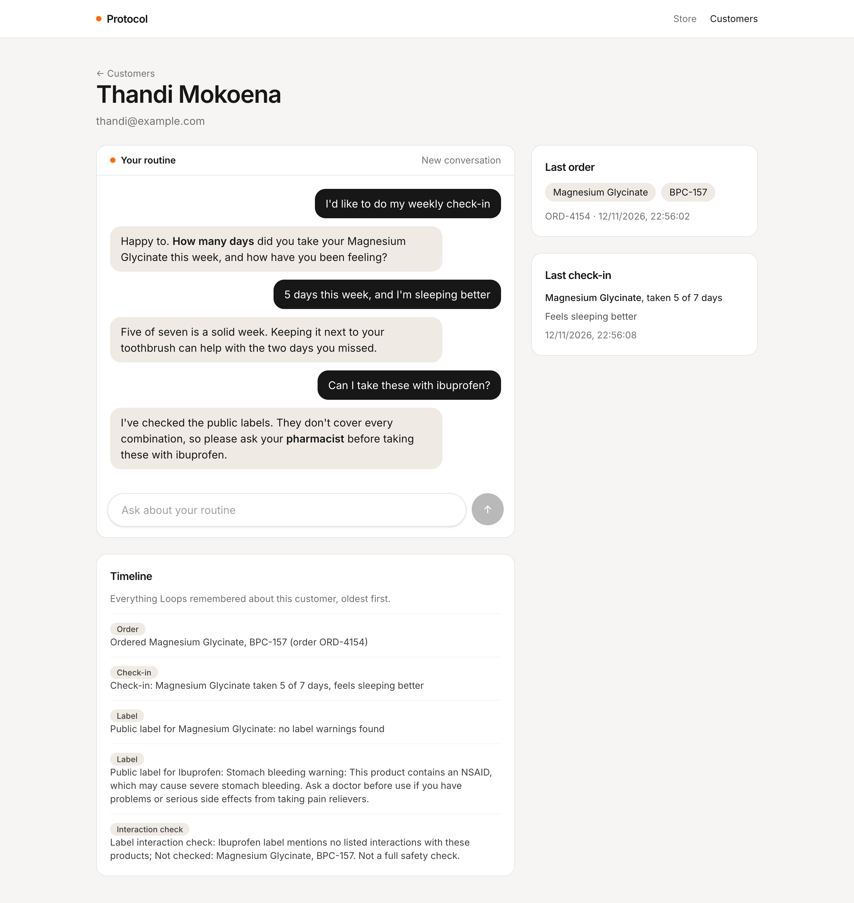
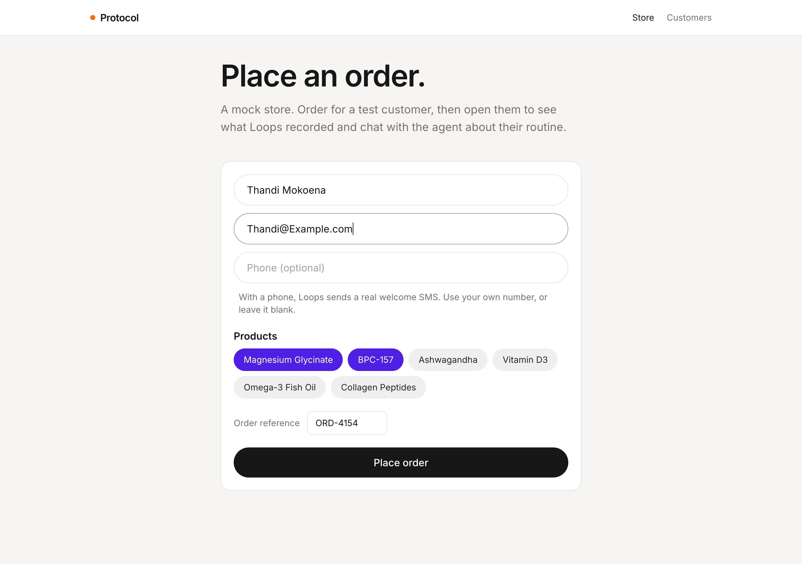
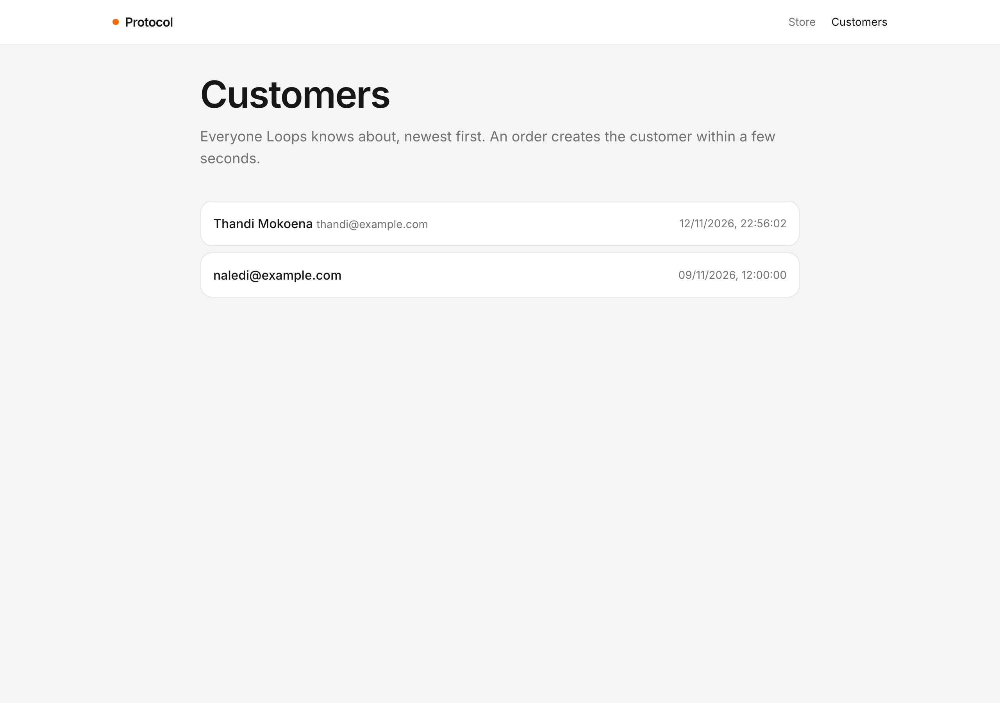

# Protocol

A small [TanStack Start](https://tanstack.com/start) app for testing the Loops **Protocol agent**. It's a mock store: place an order for a test customer, then open them to see what Loops recorded and chat with the agent about their routine. Weekly check-ins and label checks show up on the customer as they're saved.



| Placing an order                                                  | Customers                                                |
| ----------------------------------------------------------------- | -------------------------------------------------------- |
|  |  |

## Run it

1. Run Loops locally (the API listens on `http://localhost:8787`), sign in to the dashboard, and deploy the **Protocol agent** template. Tick the optional `protocol-order-welcome` workflow.
2. Copy the organization id, the `protocol-agent` loop id and the `protocol-order-welcome` loop id from each loop's page.
3. In **Settings → API tokens**, create a token for the whole organization with access set to **Run and read**. The app calls two loops, and a token for one loop only works on that loop.
4. Copy `.env.example` to `.env` and fill in those values.
5. From the repository root, run `bun install` and then `bun run dev --filter=protocol`. The app runs on `http://localhost:3006`.

Restart the dev server after changing `.env`.

To put a chat link in the welcome SMS, set `PROTOCOL_CHAT_URL` under **Variables and secrets** on `protocol-order-welcome`.

## How it works

| File                                   | What it does                                                     |
| -------------------------------------- | ---------------------------------------------------------------- |
| `src/lib/loops.ts`                     | Server functions for the Loops endpoints the app uses.           |
| `src/lib/customers.ts`                 | What Loops doesn't store: names, thread ids and transcripts.     |
| `src/lib/products.ts`                  | The store's products, named as the brand's catalogue names them. |
| `src/routes/index.tsx`                 | The store's order form.                                          |
| `src/routes/customers.index.tsx`       | Everyone Loops knows about.                                      |
| `src/routes/customers.$customerId.tsx` | A customer's order, last check-in, timeline and the chat.        |

### Keeping the token on the server

The API token can run and read every loop in the organization, so it must never reach the browser. Every call to Loops lives in a `createServerFn` in `src/lib/loops.ts`. The browser calls the server function, and only the server talks to Loops.

### The four endpoints

| Endpoint                             | Used for                                            |
| ------------------------------------ | --------------------------------------------------- |
| `POST /` on `protocol-order-welcome` | Placing an order.                                   |
| `POST /chat` on `protocol-agent`     | Sending one message and getting the reply.          |
| `GET /users`                         | The customer list, 50 at a time with **Load more**. |
| `GET /users/{userId}`                | A customer's order, check-in and memory.            |

All paths start with `/loop/{organizationId}/{loopId}`. The two other workflows, `protocol-check-in` and `protocol-label-check`, are started by the agent's tools.

### Placing an order

Unlike the other examples, this app starts a workflow itself. The store posts to `protocol-order-welcome`:

```json
{
  "customerId": "thandi@example.com",
  "products": ["Magnesium Glycinate", "BPC-157"],
  "orderId": "ORD-1042"
}
```

The customer's email is their Loops id, both here and in the chat. With a phone number, the workflow sends a real welcome SMS, so leave it blank or use your own number.

The response only means the run started. The order is recorded a few seconds later, and that's also what creates the customer in Loops. So the store sends you to the customer's page with the order reference in the URL, and the page refetches every 3 seconds until `metadata.lastOrderId` matches. If it doesn't after 30 seconds, the page points you to the run in the dashboard.

A new order replaces `products`, so it also starts a new conversation about them.

### Telling the agent who it's talking to

The agent can't read the customer's metadata, so it doesn't know what they bought. The first message of every thread starts with an intro line built from `metadata.products`, so the chat always matches the last order:

```
Hi, I'm Thandi Mokoena. My email is thandi@example.com. I ordered Magnesium Glycinate and BPC-157.

When is the best time of day to take this?
```

Loops remembers everything said in a thread, so later messages are sent on their own. Loops has no endpoint for reading a thread back, so the app keeps its own copy of the transcript.

### Check-ins and label checks

The agent saves check-ins and label checks with workflows that finish a few seconds after it replies. After each reply, the customer page checks `GET /users/{userId}` every 3 seconds for up to 30 seconds, until `lastCheckIn.checkedInAt` changes or new memory lines appear.

Metadata only keeps the latest check-in, and label checks are only saved as memory. So the timeline, which tags each memory line as an order, check-in, label or interaction check, is the full history.

Most supplements and peptides aren't on the public labels the check uses, so expect "no label warnings found" and "Not checked" for many products.

## Try it

1. Place an order without a phone. The customer page waits a few seconds, then shows the products and an "Ordered" line.
2. Click **I'd like to do my weekly check-in** and answer the agent. **Last check-in** fills in, and a check-in line appears in the timeline.
3. Ask "Can I take these with ibuprofen?". Label and interaction check lines appear.
4. Place a second order for the same email with different products. The last order changes, the timeline has two "Ordered" lines, and the chat starts fresh.
5. With SMS set up and `PROTOCOL_CHAT_URL` set, order with your own phone number and get the welcome SMS.
