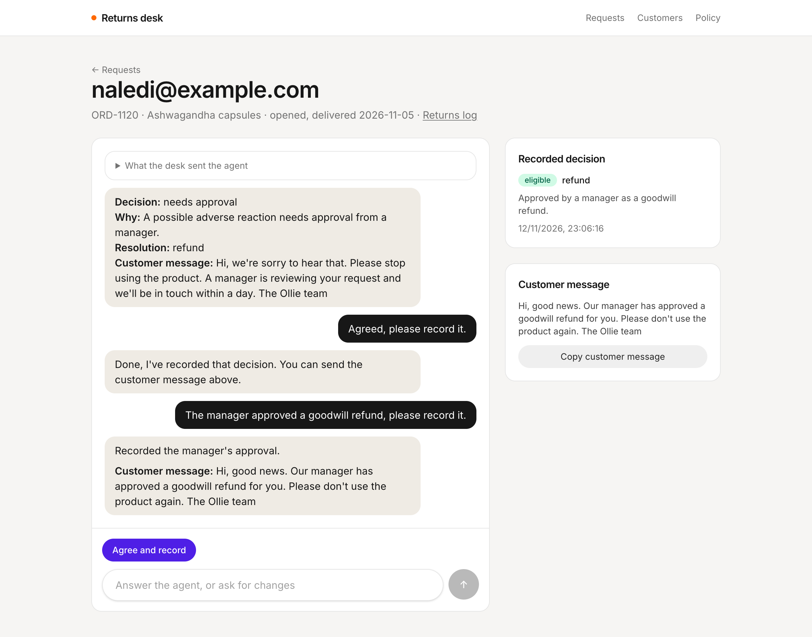
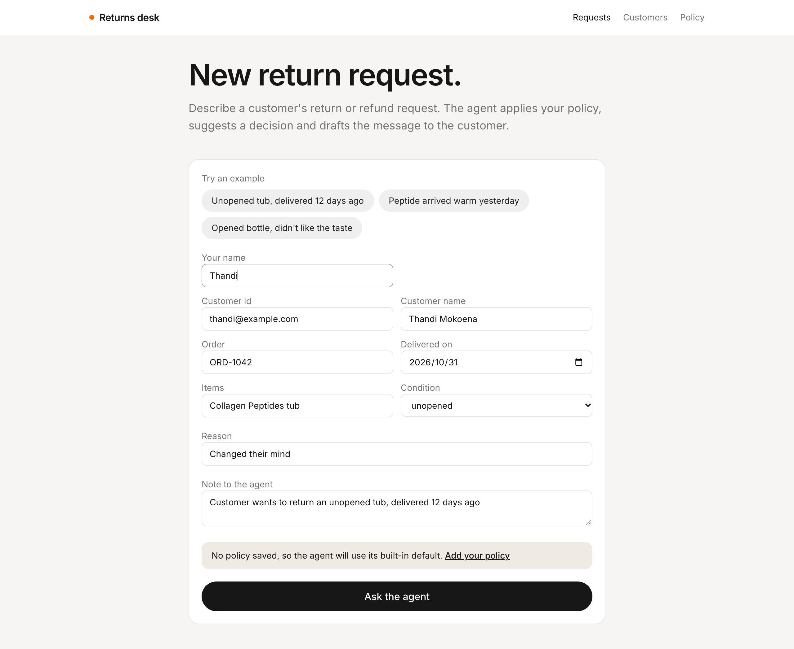
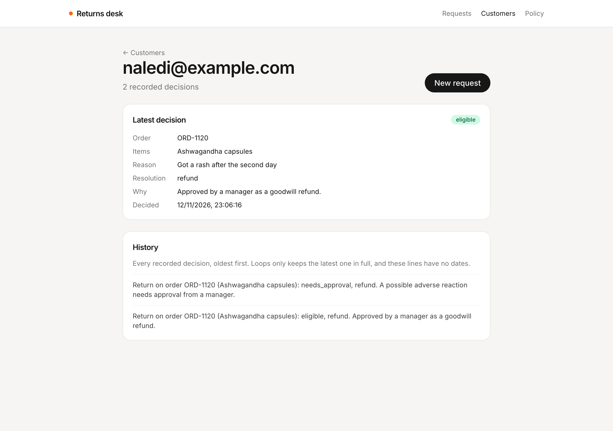

# Returns desk

A small [TanStack Start](https://tanstack.com/start) app for testing the Loops **Returns agent**. It's a returns desk for store staff: keep the store's return policy, describe a customer's return request, agree a decision with the agent, and look up each customer's returns log.



| A new request                                                            | A customer's returns log                                    |
| ------------------------------------------------------------------------ | ----------------------------------------------------------- |
|  |  |

## Run it

1. Deploy the **Returns agent** template from the dashboard. It has no optional workflows.
2. Copy the organization id and the `returns-desk` loop id from the loop's page.
3. In **Settings → API tokens**, create a token for that loop with access set to **Run and read**.
4. Copy `.env.example` to `.env` and fill in those values. To use a local Loops, set `LOOPS_API_URL` to `http://localhost:8787`.
5. From the repository root, run `bun install` and then `bun run dev --filter=returns`. The app runs on `http://localhost:3008`.

Restart the dev server after changing `.env`.

## How it works

| File                                   | What it does                                                           |
| -------------------------------------- | ---------------------------------------------------------------------- |
| `src/lib/loops.ts`                     | Server functions for the three Loops endpoints the app uses.           |
| `src/lib/desk.ts`                      | What Loops doesn't store: the policy, requests, transcripts and names. |
| `src/routes/index.tsx`                 | The request form and recent requests.                                  |
| `src/routes/requests.$requestId.tsx`   | One request's conversation, its recorded decision and the draft.       |
| `src/routes/policy.tsx`                | The store's return policy.                                             |
| `src/routes/customers.index.tsx`       | Everyone in the organization.                                          |
| `src/routes/customers.$customerId.tsx` | A customer's returns log.                                              |

### Keeping the token on the server

The API token can run and read the agent, so it must never reach the browser. Every call to Loops lives in a `createServerFn` in `src/lib/loops.ts`. The browser calls the server function, and only the server talks to Loops.

### The three endpoints

| Endpoint              | Used for                                                                 |
| --------------------- | ------------------------------------------------------------------------ |
| `POST /chat`          | Describing a request, answering the agent, and agreeing.                 |
| `GET /users`          | The customer list, 50 at a time with **Load more**.                      |
| `GET /users/{userId}` | A customer's past returns, and checking whether a decision was recorded. |

All three paths start with `/loop/{organizationId}/{loopId}`. The `return-decision` workflow is started by the agent's tool.

### Staff talk to the agent, about a customer

Unlike the other examples, the person chatting isn't the customer. The decision is saved on the customer, under the id the staff member gives the agent. Loops saves nothing about the staff member.

The agent can't read the customer, and isn't told to ask for their id, so the first message of each request says everything:

```
I'm Thandi from the returns team.

Our return policy:
- Unopened items within 30 days of delivery: refund or store credit.
- Opened items: store credit only, within 14 days of delivery.

Customer: thandi@example.com
Order: ORD-1042, delivered 2026-10-31
Items: Collagen Peptides tub
Condition: unopened
Reason: Changed their mind
Past returns: none

Customer wants to return an unopened tub, delivered 12 days ago
```

Before sending, the app reads the customer from Loops and lists their past decisions, since repeat claims change the outcome and the agent only knows about them if you say so. You can see exactly what was sent under **What the desk sent the agent** on each request.

### The policy

There's nowhere to store a policy in Loops, so the **Policy** page saves it in the browser, and each new request sends it in the first message. A request keeps the policy it started with. With no policy, the request form says so, and the agent uses the default written into its instructions.

### Agreeing and recording

The agent answers with a decision, the rule it applied, a resolution and a draft customer message. It only records once staff agree, so **Agree and record** sends "Agreed, please record it."

The decision is saved by a workflow that finishes a few seconds after the reply. After each reply, the request page checks `GET /users/{customerId}` every 3 seconds for up to 30 seconds, until `lastReturn.decidedAt` changes, then shows the recorded decision.

The agent only drafts the customer message, and nothing in the template sends it. **Copy customer message** copies the latest draft so staff can send it themselves.

### Needs approval

`needs_approval` is only a recorded value. It doesn't pause anything or alert anyone, and the manager decides outside Loops. When a request is recorded as needing approval, **Manager approved** tells the agent the outcome in the same thread, and it records a second decision for the same order.

### The returns log

Loops keeps the latest decision in `metadata.lastReturn` and a count in `returnCount`. Every decision also adds a "Return on order" memory line, which is the only full history. Those lines have no dates, and use raw values such as `needs_approval`.

`GET /users` lists everyone in the organization, so other loops' users can show up too. Names come from requests made in this browser, falling back to the id.

## Try it

1. With no policy saved, pick **Unopened tub, delivered 12 days ago** and click **Ask the agent**. The agent decides using its default policy.
2. Click **Agree and record**. Within a few seconds the recorded decision appears, and the customer's log shows one decision.
3. On **Policy**, click **Use an example** and save it. Then try **Opened bottle, didn't like the taste**. The agent quotes your rule, and the request lists the customer's past returns.
4. Describe a possible reaction, such as "Got a rash after the second day". The decision is needs approval. Agree, then click **Manager approved**. The log shows two lines for that order.
5. Start a request with no delivery date. The agent asks for it before deciding, and you answer in the chat.
