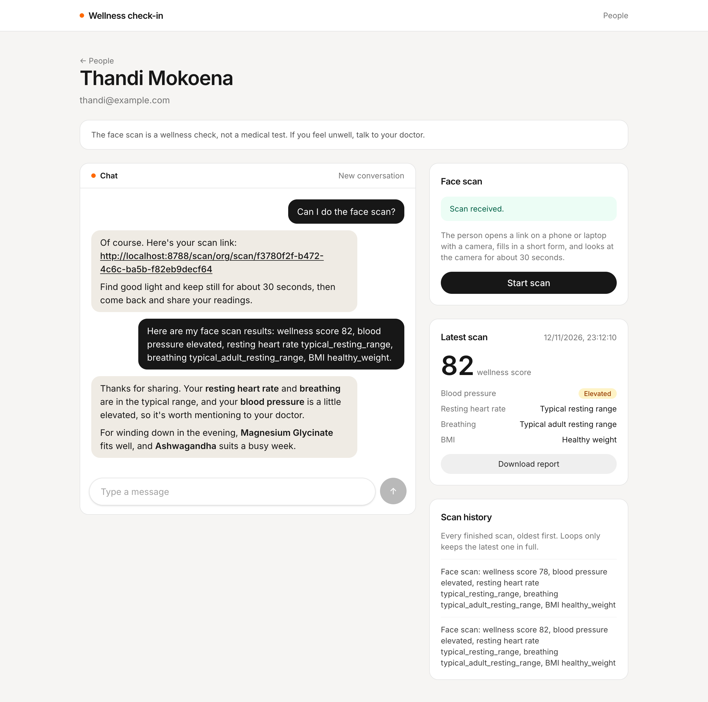
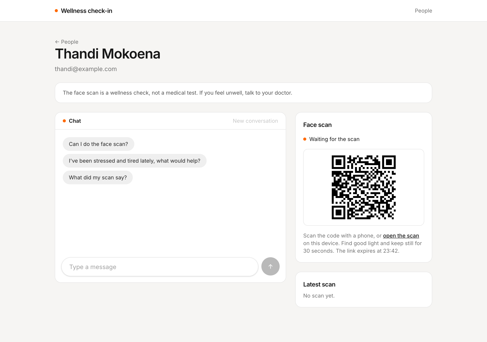
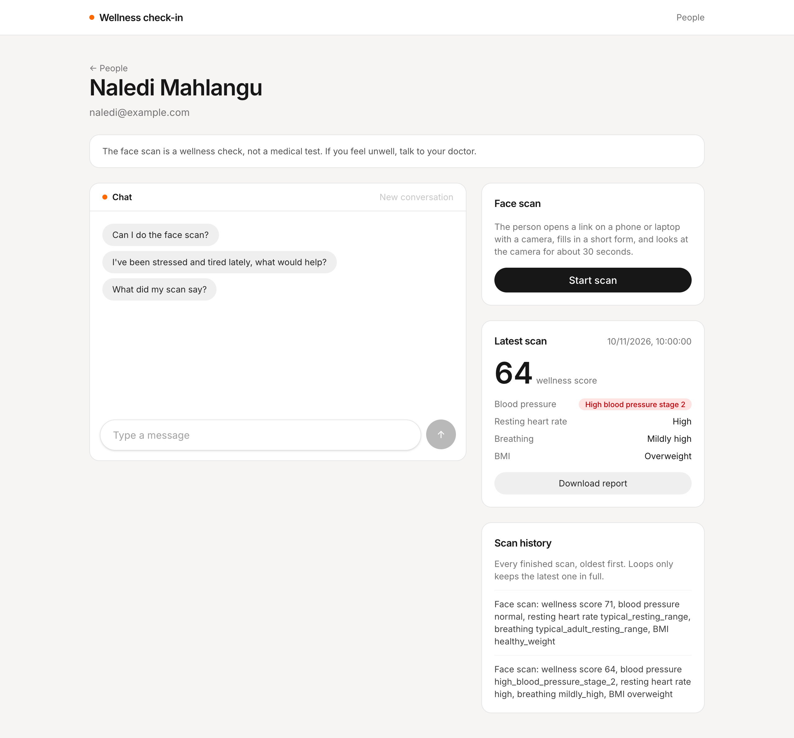

# Wellness check-in

A small [TanStack Start](https://tanstack.com/start) app for testing the Loops **Scan to recommendation agent**. Add a person, send them through a 30 second face scan, watch the results land on them, and chat with the agent about products that fit.



| Waiting for a scan                                                      | A person with earlier scans                                                        |
| ----------------------------------------------------------------------- | ---------------------------------------------------------------------------------- |
|  |  |

## Run it

1. Deploy the **Scan to recommendation agent** template from the dashboard. The scan workflow deploys with the agent, so there's nothing to tick.
2. Copy the organization id, the `scan-recommendation` loop id and the `scan-recommendation-scan` loop id from each loop's page.
3. In **Settings → API tokens**, create a token for the whole organization with access set to **Run and read**. The app calls two loops, and a token for one loop only works on that loop.
4. Copy `.env.example` to `.env` and fill in those values. To use a local Loops, set `LOOPS_API_URL` to `http://localhost:8787`.
5. From the repository root, run `bun install` and then `bun run dev --filter=scan-recommendation`. The app runs on `http://localhost:3010`.

Restart the dev server after changing `.env`.

The scan needs a camera and a browser that can run the scan engine, such as Chrome, Firefox or an up-to-date Safari. A phone is usually easiest.

## How it works

| File                              | What it does                                                       |
| --------------------------------- | ------------------------------------------------------------------ |
| `src/lib/loops.ts`                | Server functions for the Loops endpoints, and helpers for scans.   |
| `src/lib/people.ts`               | What Loops doesn't store: names, transcripts and open scan links.  |
| `src/routes/index.tsx`            | Everyone in Loops, plus people added here who haven't scanned yet. |
| `src/routes/people.$personId.tsx` | The scan panel, latest scan, history and the chat.                 |

### Keeping the token on the server

The API token can run and read every loop in the organization, so it must never reach the browser. Every call to Loops lives in a `createServerFn` in `src/lib/loops.ts`. The browser calls the server function, and only the server talks to Loops.

### The four endpoints

| Endpoint                               | Used for                                          |
| -------------------------------------- | ------------------------------------------------- |
| `POST /` on `scan-recommendation-scan` | Starting a scan and getting its link.             |
| `POST /chat` on `scan-recommendation`  | Sending one message and getting the reply.        |
| `GET /users`                           | The people list, 50 at a time with **Load more**. |
| `GET /users/{userId}`                  | A person's latest scan and scan history.          |

All paths start with `/loop/{organizationId}/{loopId}`.

### Starting a scan

The scan itself is a page hosted by Loops, not by this app. **Start scan** triggers `scan-recommendation-scan` with the person's email as `userId`, and Loops returns a `scanUrl` straight away. The page shows it as a link that opens in a new tab and as a QR code for a phone, with the time it expires. The workflow waits 30 minutes from when the link is created, not from when it's opened.

The agent can also start a scan when asked, and send the link in its reply. Replies are rendered as markdown with bare URLs turned into links. When a reply contains a link with the organization id and the scan loop id in its path, the page treats it as an open scan too.

### Waiting for the results

Loops can't tell the app when a scan finishes. So the app keeps each open link and when it started, and refetches the person every 5 seconds until `latestScan.scanId` changes, then shows **Scan received**. After 30 minutes without a new scan, it shows **Scan not completed** and offers a new link. The reason, such as the link never being opened, is only on the run in the dashboard.

`latestScan` holds categories, not numbers, and is replaced on every scan. The raw readings are on the scan's results page and in the report. Each finished scan also adds a "Face scan:" memory line, which is the only history of earlier scans.

### Telling the agent about scans

The agent can't read `latestScan`, and the scan workflow never reports back to it. So the first message of every thread starts with an intro line, with the latest scan when there is one:

```
Hi, I'm Thandi Mokoena. My email is thandi@example.com. My last face scan: wellness score 78, blood pressure elevated, resting heart rate typical_resting_range, breathing typical_adult_resting_range, BMI healthy_weight.

What did my scan say?
```

The email is also how the agent's own scans get saved on the right person. When a scan finishes during a thread, **Share my results** sends the new results as the next message.

## Try it

1. Add a person and click **Start scan**. The link and QR code appear, and the person shows up in the people list.
2. Open the link on a phone and finish the scan. Within about a minute the page says **Scan received** and shows the latest scan, and the report downloads.
3. Ask "Can I do the face scan?". The reply has a scan link that opens in a new tab, and the scan panel waits for it.
4. Finish that scan, then click **Share my results**. The agent talks through the readings and recommends products from the catalogue.
5. Start a scan and don't open it. After 30 minutes the page shows **Scan not completed**.
