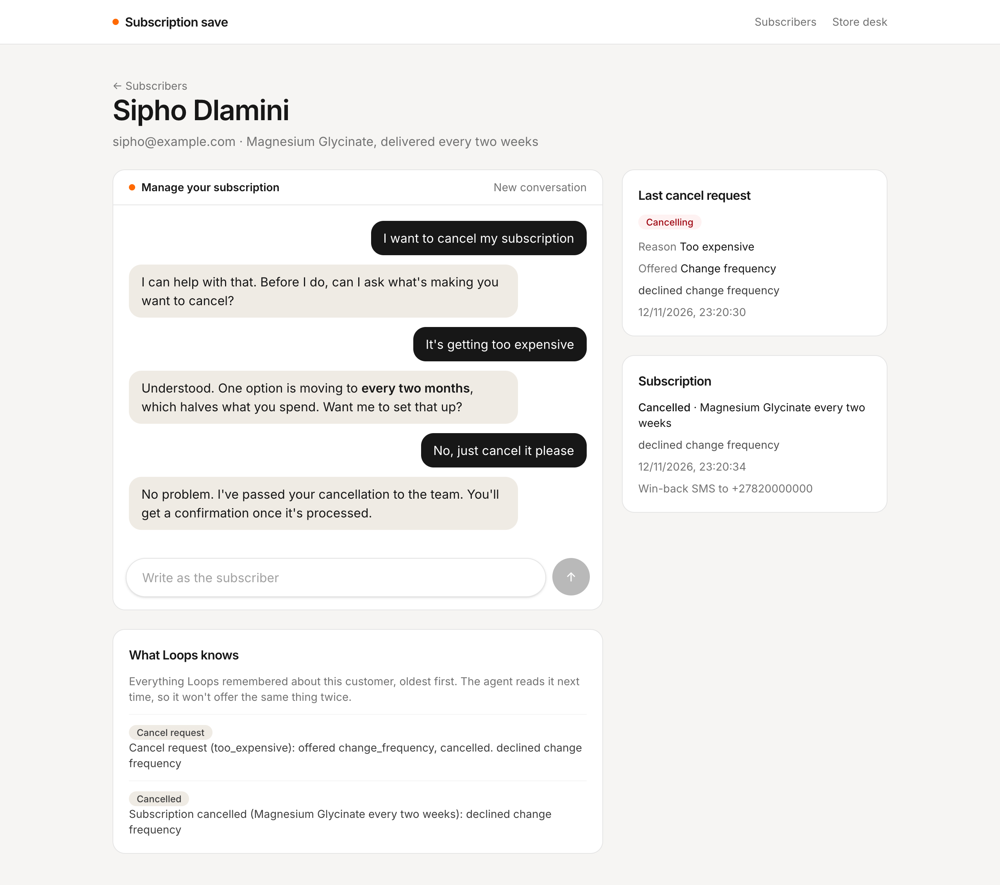
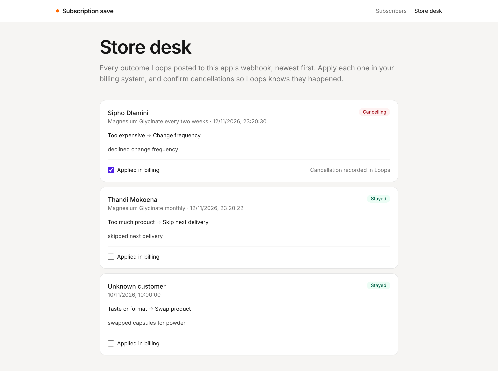
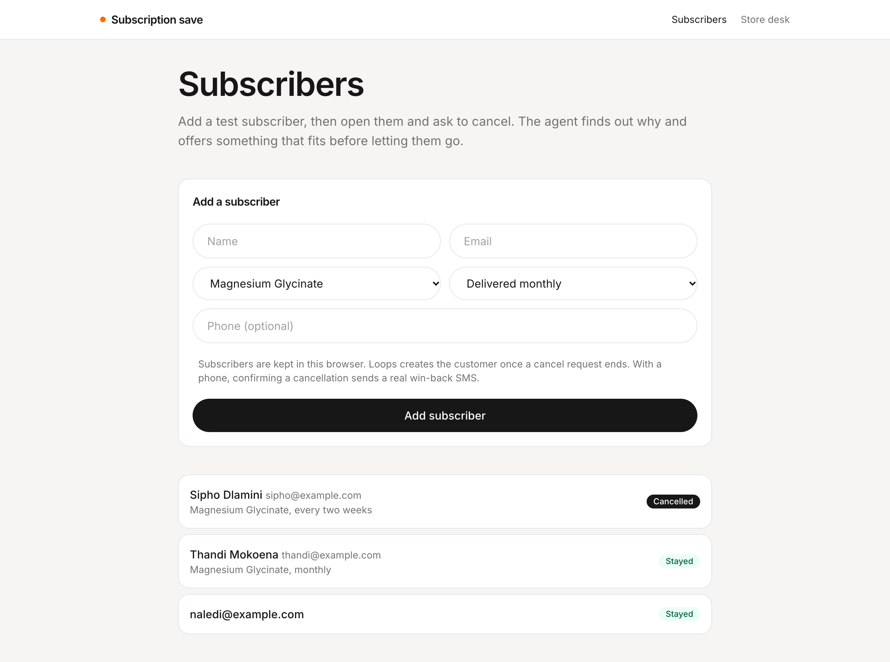

# Subscription save

A small [TanStack Start](https://tanstack.com/start) app for testing the Loops **Subscription save agent**. It's a mock subscription store: add a test subscriber, ask the agent to cancel as them, watch the outcome arrive at the store's webhook, then confirm the cancellation from the store desk.



| The store desk                                                                                | Subscribers                                                                |
| --------------------------------------------------------------------------------------------- | -------------------------------------------------------------------------- |
|  |  |

## Run it

1. Run Loops locally (the API listens on `http://localhost:8787`), sign in to the dashboard, and deploy the **Subscription save agent** template. Tick the optional `subscription-cancelled` workflow.
2. Copy the organization id, the `subscription-save` loop id and the `subscription-cancelled` loop id from each loop's page.
3. In **Settings → API tokens**, create a token for the whole organization with access set to **Run and read**. The app calls two loops, and a token for one loop only works on that loop.
4. Copy `.env.example` to `.env` and fill in those values. Set `SUBSCRIPTION_WEBHOOK_KEY` to a long random string.
5. On `subscription-save-outcome`, under **Variables and secrets**, set `SUBSCRIPTION_WEBHOOK_URL` to `http://localhost:3012/api/subscription-outcome?key=<your key>`, and add the app's host to the loop's allowed hosts.
6. From the repository root, run `bun install` and then `bun run dev --filter=subscription-save`. The app runs on `http://localhost:3012`.

Restart the dev server after changing `.env`. If Loops doesn't run on your machine, the webhook URL has to be one it can reach, for example through a tunnel.

## How it works

| File                                     | What it does                                                           |
| ---------------------------------------- | ---------------------------------------------------------------------- |
| `src/lib/loops.ts`                       | Server functions for the Loops endpoints the app uses.                 |
| `src/lib/subscribers.ts`                 | What Loops doesn't store: subscribers, their plans, threads and chats. |
| `src/lib/outcomes.server.ts`             | The webhook's store: every outcome received, in `.data/outcomes.json`. |
| `src/lib/outcomes.ts`                    | Server functions the store desk uses to read and update that store.    |
| `src/routes/api/subscription-outcome.ts` | The webhook receiver.                                                  |
| `src/routes/index.tsx`                   | The add-subscriber form and the subscriber list.                       |
| `src/routes/customers.$customerId.tsx`   | A subscriber's cancel chat and what Loops knows about them.            |
| `src/routes/desk.tsx`                    | The store desk: outcomes to apply, and cancellations to confirm.       |

### Keeping the token on the server

The API token can run and read every loop in the organization, so it must never reach the browser. Every call to Loops lives in a `createServerFn` in `src/lib/loops.ts`. The browser calls the server function, and only the server talks to Loops.

### The endpoints

| Endpoint                             | Used for                                                     |
| ------------------------------------ | ------------------------------------------------------------ |
| `POST /chat` on `subscription-save`  | Sending one message and getting the reply.                   |
| `POST /` on `subscription-cancelled` | Confirming a cancellation from the store desk.               |
| `GET /users`                         | The subscriber list, 50 at a time with **Load more**.        |
| `GET /users/{userId}`                | A subscriber's last cancel request, cancellation and memory. |

All paths start with `/loop/{organizationId}/{loopId}`. The `subscription-save-outcome` workflow is started by the agent's `record_outcome` tool, not by the app.

### Subscribers live in the app

Loops only learns about a customer once a cancel request ends or a cancellation is confirmed, so the app keeps its own subscribers in the browser: name, email, plan and phone. The email is the customer's Loops id. The list shows your subscribers first, then anyone else Loops knows about, each with how their last request ended.

### Telling the agent who it's talking to

The agent can't read the store, so it doesn't know the subscriber's plan. The first message of every thread starts with an intro line:

```
Hi, I'm Thandi Mokoena. My email is thandi@example.com. I have the Magnesium Glycinate subscription, delivered monthly.

I have too much product piling up
```

Loops remembers everything said in a thread, so later messages are sent on their own. Loops has no endpoint for reading a thread back, so the app keeps its own copy of the transcript.

### Recording the outcome

Once the subscriber decides, the agent records the reason, the offer and whether they stayed. That runs in a workflow a few seconds after the reply, so the subscriber page checks `GET /users/{userId}` every 3 seconds for up to 30 seconds, until `metadata.subscriptionSave.decidedAt` changes.

Metadata only keeps the latest outcome. Memory has a "Cancel request" line for each one, so the timeline is the full history, and it's what stops the agent offering the same thing twice.

### Receiving the outcome

With `SUBSCRIPTION_WEBHOOK_URL` set, the same workflow posts each outcome to `/api/subscription-outcome`:

```json
{
  "userId": "thandi@example.com",
  "reason": "too_much_product",
  "offer": "skip_next",
  "outcome": "stayed",
  "details": "skipped next delivery",
  "decidedAt": "2026-11-12T09:30:00.000Z"
}
```

The request isn't signed, so the receiver turns away anything without the right `?key=` with a 404. It saves the body to `.data/outcomes.json` and returns `200`. Loops can retry a failed step, so an outcome with the same `userId` and `decidedAt` is only saved once. Use a database instead of the file for anything real.

`userId` is missing when the agent didn't learn who it was talking to. The desk shows those as **Unknown customer**.

### The store desk

The desk lists every outcome the webhook received, newest first, and checks for new ones every 5 seconds. Tick **Applied in billing** once you've made the change, such as skipping the delivery.

An outcome of `cancelled` doesn't cancel anything. It's the agent passing the request on. **Confirm cancellation** is the store saying it's done: it posts to `subscription-cancelled` with the plan and phone the app knows about:

```json
{
  "customerId": "sipho@example.com",
  "plan": "Magnesium Glycinate every two weeks",
  "phone": "+27820000000",
  "reason": "declined change frequency"
}
```

The response only means the run started, so the desk checks the customer for up to 30 seconds until `metadata.subscription.cancelledAt` changes. With a phone, the workflow texts a real win-back SMS, so leave it blank or use your own number. Set `RESTART_URL` on the workflow to put a link in it.

## Try it

1. Add a subscriber without a phone and open them. Click **I have too much product piling up** and accept the offer. **Last cancel request** fills in with "Stayed", and the outcome appears on the store desk.
2. Add a second subscriber, click **I want to cancel my subscription**, give a reason and turn down the offer. The desk shows the outcome as "Cancelling".
3. On the desk, tick **Applied in billing** and click **Confirm cancellation**. The subscriber page now shows the cancellation, and the timeline has a "Subscription cancelled" line.
4. Ask to cancel again as the first subscriber. The agent remembers what it offered last time.
5. With SMS set up, confirm a cancellation for a subscriber with your own phone number and get the win-back SMS.
