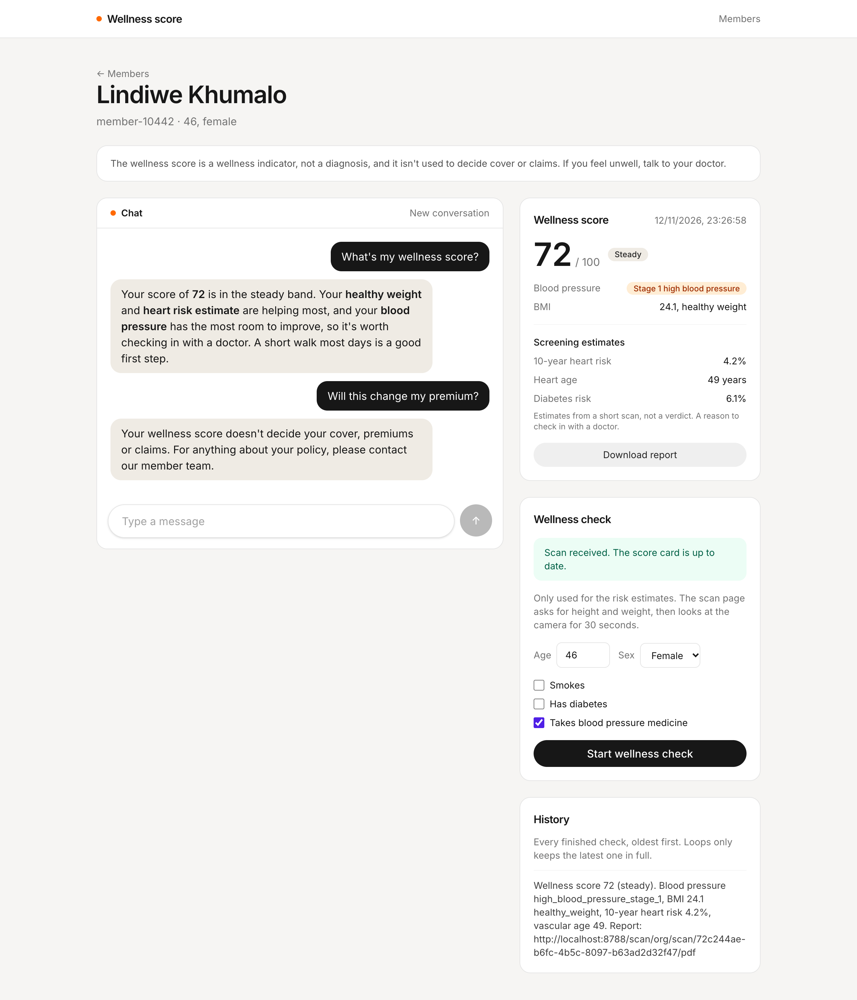
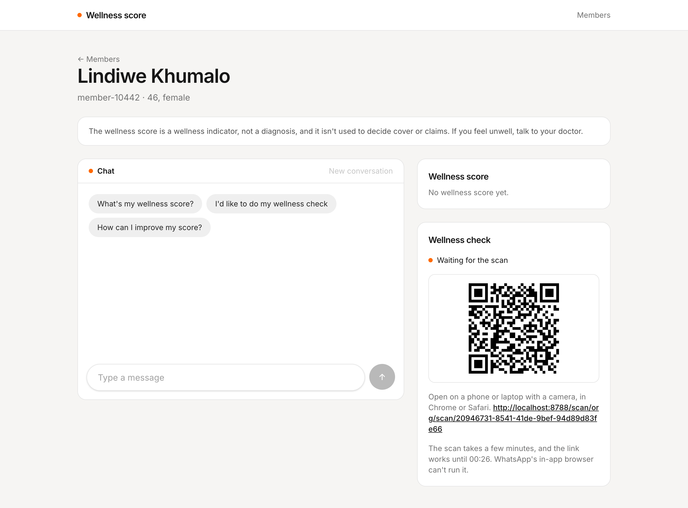
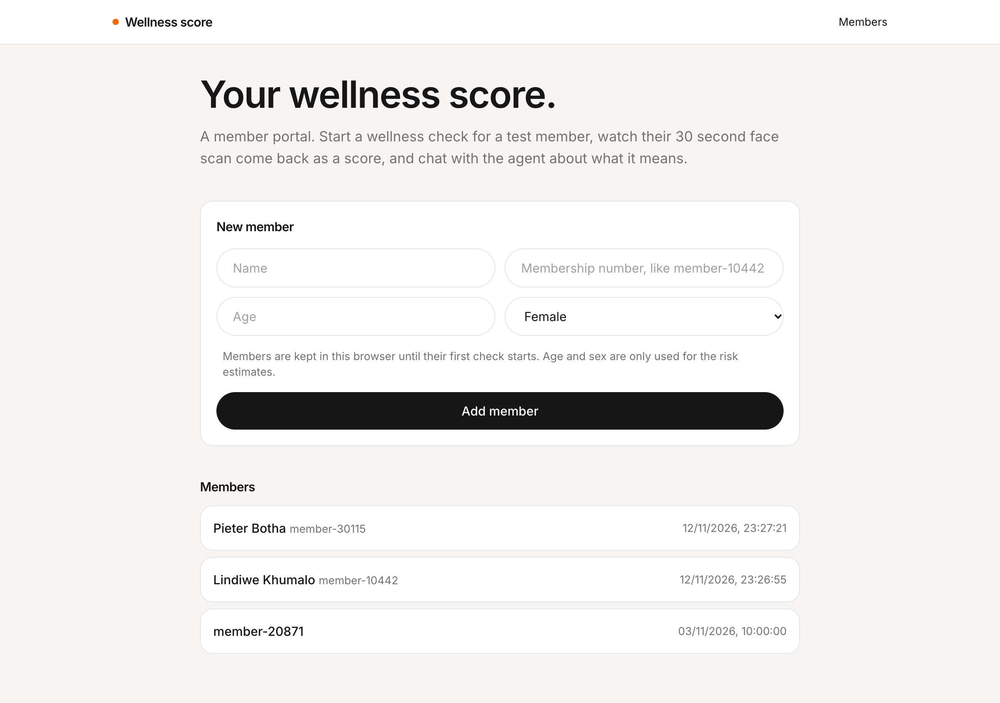

# Wellness score

A small [TanStack Start](https://tanstack.com/start) app for testing the Loops **Insurer wellness score agent**. It's a mock insurer or employer portal: add a test member, start a wellness check, watch their face scan come back as a wellness score, and chat with the agent about what it means.



| A check in progress                                                                | Members                                                                  |
| ---------------------------------------------------------------------------------- | ------------------------------------------------------------------------ |
|  |  |

## Run it

1. Run Loops locally (the API listens on `http://localhost:8787`), sign in to the dashboard, and deploy the **Insurer wellness score agent** template.
2. Copy the organization id, the `wellness-score` loop id and the `wellness-score-scan` loop id from each loop's page.
3. In **Settings → API tokens**, create a token for the whole organization with access set to **Run and read**. The app calls two loops, and a token for one loop only works on that loop.
4. Copy `.env.example` to `.env` and fill in those values.
5. From the repository root, run `bun install` and then `bun run dev --filter=wellness-score`. The app runs on `http://localhost:3014`.

Restart the dev server after changing `.env`. There's nothing to set under **Variables and secrets** for this template.

## How it works

| File                               | What it does                                                                  |
| ---------------------------------- | ----------------------------------------------------------------------------- |
| `src/lib/loops.ts`                 | Server functions for the Loops endpoints the app uses.                        |
| `src/lib/members.ts`               | What Loops doesn't store: names, health answers, open checks and transcripts. |
| `src/components.tsx`               | Dates, and the score band and blood pressure in words.                        |
| `src/routes/index.tsx`             | The **New member** form and everyone with a check.                            |
| `src/routes/members.$memberId.tsx` | A member's score card, wellness check, history and the chat.                  |

### Keeping the token on the server

The API token can run and read every loop in the organization, so it must never reach the browser. Every call to Loops lives in a `createServerFn` in `src/lib/loops.ts`. The browser calls the server function, and only the server talks to Loops.

### The endpoints

| Endpoint                          | Used for                                          |
| --------------------------------- | ------------------------------------------------- |
| `POST /` on `wellness-score-scan` | Starting a wellness check.                        |
| `POST /chat` on `wellness-score`  | Sending one message and getting the reply.        |
| `GET /users`                      | The member list, 50 at a time with **Load more**. |
| `GET /users/{userId}`             | A member's latest score and memory.               |

All paths start with `/loop/{organizationId}/{loopId}`.

### Members

A member's id is their membership or policy number, both in Loops and in the chat. Loops creates the member when their first check starts, not when they finish it, so the **New member** form keeps the name, membership number, age and sex in the browser until then. The list shows those drafts as "No check yet".

### Starting a wellness check

The check form asks for age, sex and three health questions, prefilled from the last check. It posts them to `wellness-score-scan`:

```json
{
  "memberId": "member-10442",
  "age": 46,
  "gender": "female",
  "smoker": false,
  "hasDiabetes": false,
  "isTreatedForHypertension": true
}
```

These only go into the risk estimates. The template's payload example shows `userId`, but the workflow reads `memberId`, and the risk estimates can't be trusted without `age` and `gender`.

The response carries a `scanUrl` straight away. The app shows it as a link and a QR code, and keeps it with the time the check started. The member opens it on a phone or laptop with a camera, in Chrome or Safari, enters height and weight, and looks at the camera for 30 seconds. WhatsApp's in-app browser can't run the scan.

### Waiting for the score

There's no endpoint for the run's status, so while a check is open the member page refetches `GET /users/{userId}` every 10 seconds, until `metadata.wellnessScore.scannedAt` changes. The run waits up to an hour for the scan. After an hour without a score, the page says "The scan wasn't taken" and offers a new check. Nothing is saved for a check that wasn't taken, so the previous score stays.

### The score card

The card shows the score out of 100 with its band, the blood pressure and BMI in words, such as "Stage 1 high blood pressure", and a **Download report** link to the PDF. The three risk figures are labelled as screening estimates. Nothing about cover or premiums appears next to them.

Only the latest score is kept in metadata. Each check adds a "Wellness score" line to memory, so the history is the only place earlier scores live.

### Telling the agent the score

The agent can't read the member's metadata, so it never learns the score on its own. The first message of every thread carries the membership number, the health answers, so the agent doesn't need to ask before a check, and the latest score:

```
Hi, I'm Lindiwe Khumalo. My membership number is member-10442. I'm 46 and female. I don't smoke, I don't have diabetes, I take blood pressure medicine. My wellness score from 12 November is 72 (steady). Blood pressure: high_blood_pressure_stage_1. BMI: 24.1 (healthy_weight). 10-year heart risk: 4.2%. Vascular age: 49. Diabetes risk: 6.1%.

What's my wellness score?
```

Loops remembers everything said in a thread, so later messages are sent on their own. If a new score arrives while a thread is open, the chat offers **Share my new score**, which sends "My scan just finished: my wellness score is…" as the next message.

### A check started from the chat

When the member says "I'd like to do my wellness check", the agent starts the check itself and puts the scan link in its reply. The app spots the link, which contains the organization and `wellness-score-scan` loop ids, and follows it like a check it started.

## Try it

1. Add a member and start a wellness check. Within a few seconds they're in the list with no score, and the page shows the scan link.
2. Open the link on a phone and finish the scan. The score card fills in, **Download report** opens the PDF, and a line appears in the history.
3. Click **What's my wellness score?**. The agent explains the score without mentioning cover, premiums or claims.
4. Ask "Will this change my premium?". It says the score doesn't decide that and points you to the member team.
5. Start a new conversation and click **I'd like to do my wellness check**. Finish the scan in the reply, then click **Share my new score**.
6. Start a check and don't open the link. After an hour the page says the scan wasn't taken, and the run shows as failed in the dashboard.
